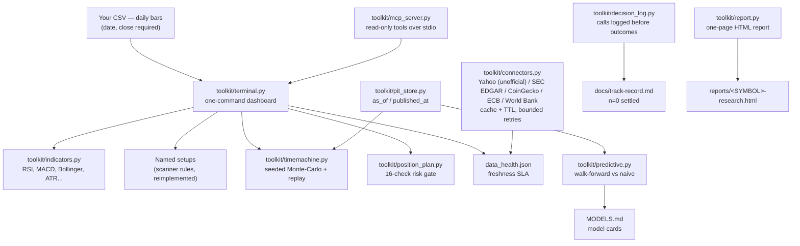

# Investment Analyst Toolkit

[](https://github.com/ShirjanKhadka1/investment-analyst-toolkit/actions/workflows/test.yml)
[](LICENSE)
[](docs/track-record.md)
[](https://m8ven.ai/mcp/shirjankhadka1-investment-analyst-toolkit-x7r1ve?s=readme)

**One command, no keys, no installs beyond Python 3.10+, a result in under 60 seconds:**

```bash
python -m toolkit.terminal demo.csv
```

`demo.csv` is synthetic sample data, not real market data: a seeded
random walk (seed 5, start 1000, daily drift +0.12%, volatility
1.2%), 80 weekday bars 2026-07-20 to 2026-11-06, NEPSE-style prices
in NPR, symbol DEMO. Generated 2026-11-07; the provenance is in the
file header, and the worked example below repeats it.

A free terminal that turns any daily-bars CSV into indicators, setups, honest Time-Machine odds and a risk gate — with every number reproducible.

> **NEPSE, native:** sourced frictions, effective-dated rules, the Time Machine and a zero-LLM rules mode — NEPSE is the tested, default market, and NEPSE data is CSV-only by design.
>
> **World markets, supported:** US, India, UK, crypto and FX via sourced market profiles, SEC EDGAR fundamentals and keyless public connectors — labelled tested or experimental in [`docs/global-evidence.md`](docs/global-evidence.md).

> **Research and education only — not investment advice, never a buy/sell/hold recommendation.** Every example uses clearly-labelled demo data unless a source is cited. The track-record badge reads n=0 honestly: no research call has been logged and settled yet (see [docs/track-record.md](docs/track-record.md)), and it stays at n=0 until a real call settles.

## Install — first result in under 60 seconds

```bash
git clone https://github.com/ShirjanKhadka1/investment-analyst-toolkit.git
cd investment-analyst-toolkit
python -m toolkit.terminal demo.csv
```

No `pip install` step: the toolkit is standard-library only, so there is nothing to install beyond Python 3.10+ itself. No API key, no account, no network. Timed 2026-11-07 on this machine: a clean clone plus the command above took **2.3 seconds** end to end. (Your machine and network will differ; the point is that the only wait is the clone.)

One exception, Windows only: the daily track-record script needs the IANA time-zone database, which Windows does not ship — on Windows, install the optional tzdata extra first: `pip install -r requirements-tzdata.txt` (data only; the toolkit itself stays standard-library only). Without it the session state is unknown and the run refuses instead of guessing.

## Watch it run (10 seconds)


The GIF above is rendered from a real run of the command (11 frames, one per four output lines; the full output is in [docs/demo-transcript.md](docs/demo-transcript.md)). The same output as an animated SVG: [docs/demo.svg](docs/demo.svg). Both are generated by `scripts/generate_demo_assets.py` — never hand-typed, and `tests/test_demo_assets.py` fails if the transcript ever drifts from a live run.

## Worked example — real numbers from `demo.csv`

`demo.csv` is synthetic example data (80 weekday bars, 2026-07-20 to 2026-11-06, symbol DEMO, NEPSE-style prices in NPR; provenance in the file header). One command prints four sections; these are the numbers it prints, pinned by `tests/test_terminal.py` and `tests/test_demo_assets.py`:

- **Indicator snapshot** — last close 1284.91, above SMA20 (1166.08) and EMA20 (1186.73); RSI(14) 88.2; MACD 12/26/9 53.32, signal 41.82; Bollinger 20/2 %B 0.91; ATR(14) 16.79.
- **Screening** — 2 of 5 named setups match: `breakout_20d` (close 1284.91 above the 20-day high 1274.72) and `bull_flag` (+12.07% run, last-5 range 3.24%). A match means the past closes satisfy a stated rule — not a buy/sell signal.
- **Time-Machine odds** — hypothetical plan entry 1284.91, stop 1259.72, target 1335.29 (reward:risk 2.00): target first 57.5%, stop first 39.0%, neither 3.5% over 10,000 seeded replays; historical replay 68.9% target-first over 61 past windows; average realised R 0.79. Simulation, not a prediction.
- **Risk gate** — BLOCK, 15/16 checks passed; the one BLOCK is the entry window, which is not confirmed. A PASS is not a yes.

Try it on your own file the same way: header `date,open,high,low,close,volume` (only `date` and `close` are required). See [One-command terminal](#one-command-terminal) below for every option.

## What it is — and what it is not

**It is:** a small, tested Python toolkit for the calculations an investment / research analyst actually does every day — financial ratios, DuPont decomposition, valuation multiples, a transparent DCF helper that forces you to show every input — plus a one-command terminal, a point-in-time store, walk-forward model testing against a naive baseline, a research-report pipeline and a read-only MCP server. Every function takes explicit inputs, every result can be recomputed from the inputs shown next to it, and edge cases raise errors instead of silently returning a plausible number.

**It is not:**

- Not a stock screener with live prices (no data vendor, no scraping; NEPSE data comes only from a CSV you supply).
- Not a completed valuation of any real company. Real-company case studies live in a separate repo, with sources cited, and are labelled work-in-progress until every input is verified.
- Not investment advice, and never a buy/sell/hold recommendation. A setup match or a PASS is not a yes.
- Not a trading system: it places no orders, talks to no broker, and never executes anything.

## How it compares

Honest comparison against the projects this toolkit learned from. Star counts are as inspected 2026-11-07 in the programme teardowns (not in this repo); each row states what the other project does better.

| Project | What it does better than this toolkit | What this toolkit does differently |
| --- | --- | --- |
| [FinceptTerminal](https://github.com/Fincept-Corporation/FinceptTerminal) (AGPL-3.0) | Breadth and execution: a full Bloomberg-style terminal with 201 data connectors, 22 live broker adapters and algo/RL trading. | Stdlib-only, no keys, no paid tiers, no execution at all; every number reproducible from a CSV. Ideas/formulas only — no Fincept code copied (AGPL). |
| [TradingAgents](https://github.com/TauricResearch/TradingAgents) (Apache-2.0, 121,074 stars) | LLM debate depth: a multi-agent trading-firm simulation (bull/bear debate, three-way risk committee) ending in a 5-tier Buy–Sell rating, backed by a paper. | Deterministic and keyless: a no-LLM rules mode, walk-forward testing against a naive baseline, and a decision log settled against realised returns. Needs no LLM API key and makes no LLM calls per decision. |
| [day-trader-skill](https://github.com/Jakeschincariol/day-trader-skill) (MIT, v2.0.0) | Agent-pack workflow: 11 skills, each one SKILL.md + one stdlib tool, with the Time Machine, exit math and 16-check risk gate this toolkit adapts. | A Python library + terminal instead of an agent pack, with NEPSE-aware frictions (sourced broker/SEBON/DP/CGT schedule, ±15% circuit limits since 20 Apr 2026 — 10% before — T+2). US day-trading specifics (PDT, NYSE holidays) are not carried over. |
| [OpenBB](https://github.com/openbq-org/OpenBB) (Apache-2.0, 75,185 stars) | Data breadth: one call fans out to 19 providers behind a standard provider contract, consumable from Python, REST, Excel or MCP. | Zero-dependency and CSV-first: no provider to break, a point-in-time store built in, and a freshness SLA with stale data flagged, never published silently. |
| [qlib](https://github.com/microsoft/qlib) (MIT, 50,086 stars) | ML depth: Alpha158 factors, a model zoo (LightGBM, LSTM, Transformers) and an experiment recorder, from Microsoft Research. | Model-light by design: stdlib-only walk-forward evaluation where the naive baseline usually wins — and that loss stays in the record. No heavy dependencies, no training runs. |

<!-- BEGIN GENERATED COVERAGE TABLE -->
### Coverage by reference repo

Generated by scripts/generate_capability_matrix.py from the same data as docs/CAPABILITY-MATRIX.md.

| Repo | Implemented | Partial | Not planned | Total |
|---|---|---|---|---|
| msitarzewski/agency-agents | 0 | 2 | 1 | 3 |
| BruceLanLan/augur | 3 | 0 | 1 | 4 |
| Jakeschincariol/day-trader-skill | 3 | 1 | 1 | 5 |
| santoshlite/EigenLedger | 2 | 2 | 0 | 4 |
| Fincept-Corporation/FinceptTerminal | 3 | 2 | 1 | 6 |
| fmilthaler/FinQuant | 3 | 0 | 1 | 4 |
| maybe-finance/maybe | 0 | 0 | 3 | 3 |
| Intelica/multi-agent-market-research | 0 | 2 | 1 | 3 |
| OpenBB/OpenBB | 2 | 3 | 0 | 5 |
| quarkfin/qf-lib | 1 | 2 | 0 | 3 |
| microsoft/qlib | 1 | 2 | 2 | 5 |
| ArturSepp/QuantInvestStrats | 1 | 3 | 0 | 4 |
| skfolio/skfolio | 2 | 1 | 1 | 4 |
| TauricResearch/TradingAgents | 2 | 4 | 1 | 7 |
| unionlabs/union | 0 | 1 | 1 | 2 |
| **Total** | **23** | **25** | **14** | **62** |
<!-- END GENERATED COVERAGE TABLE -->

## Architecture



## Live demo

There is **no hosted interactive demo** — this repo does not run a web service, and none is claimed. What you can open right now, on `main`:

- The demo dashboard output: [docs/demo-transcript.md](docs/demo-transcript.md) (full real output) and [docs/demo.svg](docs/demo.svg) (animated).
- A sample one-page research report: [reports/DEMO-research.html](reports/DEMO-research.html) — generated by `python -m toolkit.terminal research DEMO ...` from the demo CSVs; HTML only, no PDF dependency.
- The model cards: [MODELS.md](MODELS.md). The scoreboard: [docs/track-record.md](docs/track-record.md).
- The Nepali front door: [README.ne.md](README.ne.md).

## Roadmap

- **v0.9.0 (this release)** — Phase 2 data layer (provider-contract connectors, data-health SLA, derived refresh) + this front door (README, demo assets, Nepali README, ruff clean across the repo).
- **Next** — connector catalogue JSON; risk-sheet gap-fill; TTL/cache documentation; structural tests for the repo's own conventions. (Deferred from the programme merge plan; none started.)
- **Firsts still to observe** — the scheduled daily workflow's first run on GitHub with public output in `reports/daily/`; the first real research call logged before its outcome and settled after its horizon (the track record moves off n=0 only then).
- **Never** — live trading, order execution, paid data as a requirement, or a claim this repo has not earned. See [docs/post-mortem-prediction-failures.md](docs/post-mortem-prediction-failures.md) for how losses are kept.

## Good first issues

Real, small tasks — listed here as text and in [GOOD-FIRST-ISSUES.md](GOOD-FIRST-ISSUES.md). **No GitHub issue has been created for these yet**: open an issue first and ask to be assigned before starting, so two people do not do the same task. (The `bug` and `enhancement` labels exist on the issue templates in `.github/ISSUE_TEMPLATE/`.)

1. **Add one new ratio, with a test and a docstring citing its definition** — the contribution type named in `CONTRIBUTING.md`; follow `toolkit/ratios.py`.
2. **Add one worked example in `examples/`** — demo data only, no network, no key; assert its printed output in a test, following `examples/demo_company.py`.
3. **Proofread and extend `README.ne.md`** — the Nepali front door; check the finance terms against the English README and note any term kept in English.

House rules for every contribution: research only, not investment advice; never a buy/sell recommendation; no credentials, no private data, no paywalled scraping.

## Contributing, conduct, security

See [CONTRIBUTING.md](CONTRIBUTING.md) (open an issue first, smallest fix, test included, every new function needs a docstring + edge-case test), [CODE_OF_CONDUCT.md](CODE_OF_CONDUCT.md), [SECURITY.md](SECURITY.md) (report vulnerabilities privately via GitHub's private vulnerability reporting — never in a public issue), and [CITATION.cff](CITATION.cff) to cite this repo. Issue and pull-request templates live in `.github/`. License: MIT — see [LICENSE](LICENSE).

Start with the finding, not the promise: on the real-data and example-data
walk-forward runs recorded in this repo, the naive baseline wins. This
toolkit is tooling to test forecasts honestly — every model must beat the
naive benchmark ("tomorrow's close equals today's close") on the same
walk-forward split, and when it does not, that loss stays in the record.

Two single-symbol AAPL runs, both example periods — not general accuracy
claims, not statements about AAPL, and not statements about any NEPSE
security (AAPL is a US equity; there is no live NEPSE feed here):

| Run | Horizon | Naive MAE | Best fitted model MAE | Naive wins? |
| --- | ---: | ---: | ---: | ---: |
| Yahoo AAPL, 251 daily closes, 2025-10-29 to 2026-10-28 (docs/real-data-walk-forward-2026-10-29.md) | h = 1 | 3.7660 | 5.5880 (exp_smoothing_0.3) | Yes |
| Yahoo AAPL, 251 daily closes, 2025-10-29 to 2026-10-28 | h = 3 | 6.9771 | 8.2806 (exp_smoothing_0.3) | Yes |
| Yahoo AAPL, 251 daily closes, 2025-10-29 to 2026-10-28 | h = 5 | 9.2287 | 10.3993 (moving_average_5) | Yes |
| Labelled example file, AAPL daily closes, 2024-01-02 to 2025-12-31, 502 bars (docs/r6-example-data-walk-forward-2026-10-29.md) | h = 1 | 2.8474 | 4.5180 (exp_smoothing_0.3) | Yes |
| Labelled example file, AAPL daily closes, 2024-01-02 to 2025-12-31, 502 bars | h = 3 | 5.6394 | 6.5891 (exp_smoothing_0.3) | Yes |
| Labelled example file, AAPL daily closes, 2024-01-02 to 2025-12-31, 502 bars | h = 5 | 7.7088 | 7.9284 (exp_smoothing_0.3) | Yes |

MAE is in US dollars per share; `beats_naive` is False for every fitted
model at every horizon in both runs. MAE grows with horizon for every
model, including naive. One symbol, one period, one train/test split,
and the default four-model set only, in each run — that is the whole
claim, and it is not stretched further.

A small, tested Python toolkit for the calculations an investment / research
analyst actually does every day — financial ratios, DuPont decomposition,
valuation multiples, and a transparent DCF helper that forces you to show every
input. No black boxes, no hidden assumptions.

> **Educational use.** This is a learning and analysis toolkit, not investment
> advice, and not a recommendation to buy or sell any security. Every example
> uses clearly-labelled demo data unless a source is cited.

## Losses, kept in the record

None of these is softened, buried, or deleted. Each one is also in the
linked record named beside it.

- **Level-shift loss (synthetic fixture): naive wins, adaptive loses.**
  On the 100 to 150 level-shift fixture, naive wins at every horizon
  (MAE 3.333 at h = 1, 3.846 at h = 3, 4.545 at h = 5) and every
  non-naive model loses, including the adaptive ensemble (6.276, 7.690,
  10.382). Full table in the v0.8.0 section below and in
  `docs/post-mortem-prediction-failures.md`.
- **Noisy-flat drift loss (synthetic fixture): drift loses.** On the
  noisy-flat fixture, drift loses at every horizon (2.906 vs naive
  2.900 at h = 1; 2.164 vs 1.833 at h = 3; 3.668 vs 3.438 at h = 5):
  on a series with no real drift, the mean recent change is noise,
  and adding it hurts. Full table in the v0.8.0 section below and in
  `docs/post-mortem-prediction-failures.md`.
- **AAPL real-data naive win.** In the Yahoo AAPL walk-forward above,
  naive beat every fitted model at h = 1, 3, and 5 (naive MAE 3.7660,
  6.9771, 9.2287). Full record:
  `docs/real-data-walk-forward-2026-10-29.md`. The example-file run
  says the same thing on its own period (naive 2.8474, 5.6394, 7.7088):
  `docs/r6-example-data-walk-forward-2026-10-29.md`.
- **Scanner bullish crossover loss (example data, NOT NEPSE).** On the
  same labelled AAPL example file, the bullish EMA-crossover signal
  hit 33.3% at 5 bars (1 win, 2 losses, 3 events) against a naive rate
  of 56.5% — a lift of −23.1 points. At 20 bars it won 2 of 3 yet still
  averaged −1.87%. The bearish 20-bar lift (+18.6 points) rests on
  n = 2 with a mean forward return of −6.05% and is noise, not a win
  to quote alone. Full table, with every event and its baseline, in
  the scanner repo's backtest section:
  https://github.com/ShirjanKhadka1/nepali-capital-market-research/blob/main/scanner/README.md

## Why this exists

Most finance tutorials give you a formula and a single answer. Analyst work is
the opposite: the answer is only as good as the inputs, the definitions, and
the checks around them. This toolkit is built around that discipline:

- Every function takes explicit inputs — no global state, no magic defaults.
- Every result can be recomputed from the inputs shown next to it.
- Edge cases are handled loudly: division by zero, negative equity, and
  missing inputs raise errors instead of silently returning a plausible number.

## What is inside

| Module | What it does |
|---|---|
| `toolkit/ratios.py` | Profitability, liquidity, leverage, efficiency ratios; DuPont ROE |
| `toolkit/valuation.py` | DCF (single-stage terminal value), EV/EBITDA and P/E multiples, Gordon growth |
| `toolkit/checks.py` | Input validation: non-negative where required, rates in range, growth < discount rate |
| `toolkit/pit_store.py` | Point-in-time store: bars + fundamentals with `as_of` / `published_at`; reads return only what was published by the query date (Engine 1.1) |
| `toolkit/timemachine.py` | Seeded Monte-Carlo + historical replay, named-setup replay, honest verdict, NEPSE upgrade with circuit limits, exit-liquidity guard and sourced frictions (Engine 1.2) |
| `toolkit/terminal.py` | One-command research terminal: `python -m toolkit.terminal demo.csv` |
| `toolkit/quant.py` | Quant library: FCFF/FCFE DCF with sensitivity, bank valuation (PBV/ROE/NPL/CAR inputs as given), historical + parametric VaR/CVaR, entropic VaR, Sharpe inference, multiple-testing correction, turnover/costs, momentum + mean-reversion factors, mean-variance + HRP + max-diversification optimisation, sector rotation, Alpha158 baseline factors (Engine 1.6) |
| `toolkit/predictive.py` (Engine 1.7) | Walk-forward validation only (expanding/rolling, refit per fold), model vs naive / buy-and-hold / index report with "edge" / "no edge" verdicts, Platt calibration + Brier score, model cards, heuristic regime detection, retraining schedule, walk-forward reads through the point-in-time store; results in `MODELS.md` (generated by `scripts/generate_models_table.py`) |
| `toolkit/report.py` (Engine 1.9) | Research report pipeline: `research <SYMBOL>` builds a one-page HTML report (thesis, bull/bear, peers and sector comps, risks, cited sources) from caller-supplied bars, fundamentals, and peer rows; every number traces to an input row or is UNKNOWN; no data means the report says so plainly |
| `toolkit/mcp_server.py` (Engine 1.10) | MCP server (stdlib-only JSON-RPC over stdio: initialize, tools/list, tools/call) exposing read-only analytics as tools — indicators, screening setups, Time-Machine simulation, risk gate, quant functions, NEPSE frictions, research report. No execution, no network, no keys. NEPSE MCP servers already exist (see the module docstring); this one fetches nothing and executes nothing |

## One-command terminal

```bash
python -m toolkit.terminal demo.csv
```

Reads a CSV of daily OHLCV bars and prints a research dashboard to
stdout — no network, no keys, no live trading, no orders. The shipped
`demo.csv` is a **synthetic** example (80 weekday bars, 2026-07-20 to
2026-11-06, NEPSE-style prices in NPR, symbol DEMO; generated
2026-11-07 from a seeded random walk — see the `#` provenance lines
at the top of the file, which the CLI skips when reading). Bring your
own file the same way: header `date,open,high,low,close,volume`
(only `date` and `close` are required; `open`/`high`/`low` default
to the close, `volume` is optional and VWAP is skipped without it).

What it prints, in four sections:

1. **Indicator snapshot** — RSI(14), MACD 12/26/9, Bollinger 20/2
   (with %B), ATR(14), SMA20/EMA20 trend, ADX(14), Stochastic,
   VWAP. Values that need more history than the file holds print as
   `n/a (needs N bars)` instead of being invented.
2. **Screening** — the five named scanner setups (`breakout_20d`,
   `bull_flag`, `reclaim_ma20`, `oversold`, `oversold_bounce`),
   reimplemented here from `scanner/setups.py` so the toolkit stays
   self-contained. Each setup prints its rule and whether the past
   closes satisfy it. On the demo file, 2 of 5 match
   (`breakout_20d`, `bull_flag`).
3. **Time-Machine odds** — a seeded Monte-Carlo replay (seed 19,
   10,000 replays, 20-day horizon) of a hypothetical exit plan plus
   a deterministic historical replay of the same rule. Default plan:
   entry = last close, stop = entry − 1.5 × ATR(14), target at
   reward:risk 2 (override with `--stop`/`--target`,
   `--risk-reward`, `--horizon`, `--n-sims`, `--seed`).
4. **Risk gate** — the 16-check PASS/BLOCK checklist on that
   hypothetical plan (sized from the example research budget).
   It BLOCKs by default because the entry window is not confirmed;
   pass `--entry-window-ok` only when the plan's entry window is
   actually open.

### What it will NOT do

- It is **research and education only — not investment advice,
  never a buy/sell/hold recommendation**. A setup match means the
  past closes satisfy a stated rule, not that anything should be
  bought. A PASS is not a yes.
- The Time-Machine output is a **simulation, not a prediction**:
  resampled history is not the future, and a target-first share
  above break-even is a property of the past sample, not a
  probability of profit.
- It places no orders, talks to no broker, fetches nothing, and
  stores nothing. A bad CSV (missing file, missing columns,
  non-numeric prices, no data rows) exits non-zero with a one-line
  `error: ...` message and never a traceback; a short-but-valid
  file still prints, with the sections it cannot run replaced by a
  short note.

See `tests/test_terminal.py` for the coverage (end-to-end run,
malformed / empty / missing files, determinism, honesty labels,
short-file degradation).

## Point-in-time store (Engine 1.1)

`toolkit/pit_store.py` — every record carries `as_of` (the date the
data describes) and `published_at` (when it became available).
`bars_as_of(date)` and `fundamentals_as_of(date)` return only
records with `published_at <= date`, one per `as_of` (the latest
published revision). A backtest that reads through this store cannot
see data that was not yet published on its decision date, so
look-ahead is impossible by construction. Revisions are kept, never
overwritten; a query before anything was published returns an empty
list, never an invented row. `bars_for_timemachine(date)` feeds the
visible bars straight into `timemachine.simulate` /
`replay_history`. Zero dependencies, offline tests with synthetic
fixtures only.

## NEPSE Time Machine upgrade (Engine 1.2)

`toolkit/timemachine.py` keeps its existing `simulate` /
`replay_history` API and adds:

- **Named-setup replay** — `replay_setup(prices, setup, entry, stop,
  target)`: the deterministic replay restricted to past windows
  where one of the five named setups (`breakout_20d`, `bull_flag`,
  `reclaim_ma20`, `oversold`, `oversold_bounce`) had fired at the
  window's start, evaluated on closes visible then — never on later
  bars. The rules are reimplemented locally; this module does not
  import the scanner repo. A caller-supplied setup function is also
  accepted (`setup_fn=`).
- **Honest verdict** — every setup replay and NEPSE simulation
  carries `honest_verdict`: `"edge"`, `"coin flip"` or
  `"insufficient data"`. Thresholds, stated: fewer than 20 windows
  is `"insufficient data"`; otherwise `"edge"` only when the
  target-first share is at least 10 percentage points from
  break-even; anything in between is `"coin flip"`. "Edge"
  describes the past sample only — every result still states
  "simulation, not a prediction".
- **NEPSE simulation** — `simulate_nepse(...)`: the seeded
  Monte-Carlo with daily moves clipped to the circuit limit in
  force on each bar's date (10% before 20 Apr 2026, 15% from;
  Fourth Amendment Bylaws, 2082, SEBON-approved), an exit-liquidity guard that
  BLOCKs a position above 10% of typical daily volume instead of
  simulating it, and real trading frictions from
  `sourced_nepal_frictions()` (broker slabs 0.36%/0.33%/0.31%/
  0.27%/0.24%, SEBON 0.015%, DP Rs 25, CGT 5% ≤365d / 3.75%
  >365d — user-supplied rate-schedule screenshot, 28 Oct 2026;
  settlement T+2 as standard). `average_R` is reported net of
  those frictions, with `average_R_gross` kept for comparison.

### Worked example (synthetic demo data — reproduced by tests)

On the shipped synthetic `demo.csv`, hypothetical plan entry
1284.91, stop 1259.72, target 1335.29 (the terminal's default plan),
100 shares, typical daily volume 30,000, seed 19, 10,000 replays,
20-day horizon:

```python
from toolkit.terminal import load_bars
from toolkit import timemachine

bars = load_bars("demo.csv")
ohlc = [{"open": b["open"], "high": b["high"], "low": b["low"],
         "close": b["close"]} for b in bars]
res = timemachine.simulate_nepse(ohlc, 1284.91, 1259.72, 1335.29,
                                 shares=100,
                                 typical_daily_volume=30_000)
# target_first 57.5%, stop_first 39.0%, neither 3.5%
# break-even 33.3%, honest_verdict "edge", 61 windows
# average_R gross 0.79, net of frictions 0.37
# median final close 1334.07 (p5 1244.46, p95 1359.89)
# buy charges at entry Rs 468.29
rep = timemachine.replay_setup(ohlc, "breakout_20d",
                               1284.91, 1259.72, 1335.29)
# 11 setup windows of 61; target_first 72.7% — yet the honest
# verdict is "insufficient data" (fewer than 20 setup windows).
# bull_flag fired on 0 windows: no shares are reported at all.
```

Frictions cut the average realised R from 0.79 to 0.37 on this
example — that drag is the point of modelling them. And the
`breakout_20d` replay shows the verdict doing its job: a
72.7% target-first record on 11 windows is not an edge, it is too
little data to call. The numbers above are pinned by
`tests/test_timemachine_nepse.py`, so the README cannot drift
from the code.

## NEPSE agent team — no-LLM rules mode (Engine 1.3)

`toolkit/rules_mode.py` is the deterministic, zero-API-key fallback
for the nine NEPSE agents in
[finance-research-agents](https://github.com/ShirjanKhadka1/finance-research-agents)
(Fundamentals, Technical, News & Sentiment, Broker-flow, Macro,
Corporate Actions, Trader, Risk team, Portfolio Manager). Every
agent file states it works with any LLM, including a free local
Ollama — and this module lets the same structured outputs be
produced with no LLM at all: sector checklists (banks, hydropower,
insurance, microfinance — a missing metric is UNKNOWN, never
filled in), a technical read (momentum, 20-day mean, volatility,
RSI(14) — past bars only), a Nepali + English lexicon sentiment
count, a broker-flow read labelled INDICATIVE ONLY (broker flow
never proves who bought or why), an NRB/macro checklist, and
corporate-action flags. `run_rules_team()` runs the whole team over
supplied inputs in one structured dict. No keys, no endpoints, no
fetching; offline tests with synthetic fixtures only
(`tests/test_rules_mode.py`, 14 tests).

The companion pack holds 36 agents — 18 NEPSE-side (9-agent NEPSE
team + 8 sector agents + Nepal Market Researcher) and 18
market-agnostic — with 12 runbooks and 8 templates. The split is
counted from the pack's roster by `scripts/count_agents.py` (see
`docs/agents-roster-counts.json`); the "9 + 8 = 17" framing omits
Nepal Market Researcher, the general Nepal market researcher, who
is in neither the team nor the sector set.

## Decision memory + public scoreboard (Engine 1.4)

`toolkit/decision_log.py` logs every research call *before* its
outcome is known (`write_call`: date, symbol, thesis, horizon,
expected direction/range, sources, confidence), settles it after
its horizon (`settle_call`: realised return and alpha vs the NEPSE
index — the index return and its source are supplied by the caller
and settlement refuses an unnamed index series, so no index history
is ever invented; settling before the horizon ends is refused),
and scores the settled calls (`scoreboard`, Brier score included).
Reflections (`append_reflection`) are read by the Portfolio Manager
agent before its next run on the same symbol; the format is
documented in `toolkit/decision_log/SCHEMA.md`.

> **Track record: n=0 settled — hit rate n=0, average alpha n=0,
> Brier score n=0, wins 0 / losses 0.** See
> [`docs/track-record.md`](docs/track-record.md), regenerated from
> the log by `render_scoreboard_md` and never edited by hand. The
> scoreboard starts empty and stays at n=0 until a real call is
> logged and settled; losses are included and open calls never
> count as wins.

## Extended risk gate + paper ledger (Engine 1.5)

`toolkit/position_plan.py` keeps its 16-check `risk_gate()`
unchanged and adds `extended_risk_gate()` — the same 16 checks
plus three per-idea limits: max loss per idea, sector
concentration (existing sector exposure + this plan, as a share of
the hypothetical portfolio), and exit liquidity (reusing
`timemachine.check_exit_liquidity`). Context the extra checks need
is supplied by the caller and every check fails closed when it is
missing. A PASS from either gate is not a recommendation.
`toolkit/paper_ledger.py` records hypothetical plans and their gate
verdicts (fingerprint included) — paper only, no orders, no
execution. Tests: `tests/test_decision_log.py` (14 tests, covering
1.4 and 1.5 on synthetic fixtures).

## Research report pipeline (Engine 1.9)

`python -m toolkit.terminal research <SYMBOL> --bars bars.csv
--fundamentals fund.csv --peers peers.csv` writes a one-page HTML
report (`reports/<SYMBOL>-research.html` by default): thesis, key
figures, bull/bear, fundamentals, peers and sector comps, risks,
cited sources. Data comes from the CSVs the caller supplies; peers
and comps are labelled with their source per row, or UNKNOWN; if no
data exists for the symbol, the report says so plainly instead of
inventing figures. HTML only — no PDF dependency, stdlib only.
Tests: `tests/test_report.py` (16 tests, synthetic fixtures, offline).

## MCP server (Engine 1.10)

`python -m toolkit.mcp_server` serves JSON-RPC 2.0 over stdio
(`initialize`, `tools/list`, `tools/call`, `ping`) with eight
read-only tools: indicators, screening setups, Time-Machine
simulation, risk gate, quant risk summary, quant DCF, NEPSE
frictions, research report. Every tool works on caller-supplied
arguments; nothing is fetched, nothing is executed, no keys. NEPSE
MCP servers already exist — `razaanstha/nepse-mcp-server` (live data
via the ShareBazaar API), `nlethetech/nepse-quant-terminal`
(FastMCP, including an order lifecycle), and Lipi's remote MCP
server (including `get_nepse_index`); see the module docstring for
the full prior-art note. This server deliberately does not compete
with them: it is the MCP front door to the toolkit's own tested
functions. Tests: `tests/test_mcp_server.py` (20 tests, protocol
level, offline).

## Data layer and autonomy (Phase 2)

`toolkit/connectors.py` is the provider-contract data layer (design
adapted from OpenBB's provider contract, qf-lib's prefetching/caching
wrapper and augur's evidence time-semantics — no code copied from any
of them; see `toolkit/SOURCES_MERGE_2026-11-07.md`): one standard
interface per source, core never touches a vendor API. Priority order:
caller-supplied CSVs first (the only NEPSE path — there is no
documented free public NEPSE OHLCV API, and no live feed is
invented), then Yahoo Finance (unofficial, best-effort), CoinGecko for
crypto, ECB reference rates and the World Bank API. Each connector has
a timeout, bounded retries (transient failures only, max 3 attempts
with backoff — a 403/429 is never retried), an on-disk cache with a
per-source TTL, and a freshness SLA (daily bars and FX: 1 trading day;
World Bank annual: 1 year). Judged in trading days, not calendar days,
so Friday data is not STALE on a Sunday; NEPSE uses its Mon–Fri week
(Sun–Thu before 6 Apr 2026) and crypto counts every day. A per-market
holiday calendar (`data/holidays/nepse.json`, seeded only from official
NEPSE notices — Dashain 2083 only so far) makes a festival closure read
FRESH instead of a false STALE; a day outside the calendar's covered
range degrades freshness to UNKNOWN, never to STALE. `scripts/data_health.py` writes
`data_health.json` with per-source FRESH/STALE/UNAVAILABLE/UNKNOWN
status, last-fetch time, age and cache hits; stale data is flagged,
never published silently. The terminal dashboard shows it as section
5 (`--data-health data_health.json`). `scripts/refresh_derived.py`
refreshes `data/derived/*.json` (indicator snapshot, screening
matches, Time-Machine odds) from the repo's CSVs with `as_of`
provenance and a stale flag. Both scripts exit non-zero with a clear
error on failure, so a scheduled run can alert on it. Tests:
`tests/test_connectors.py` (43 tests), `tests/test_data_health.py`
(17 tests, including fixtures cut from real responses fetched
2026-11-07 — see `tests/fixtures/SOURCES.md`), and
`tests/test_refresh_derived.py` (8 tests), all offline.

## Tests

```bash
python -m pytest tests/ -v
```

Every public function has at least one test, including an edge-case test
(zero revenue, negative equity, growth >= discount rate). If a test fails,
the toolkit is wrong — open an issue.

Tests: 732/732 tests passing (2026-11-14, fresh clone, Python 3.12, pytest 9.2.0): 623 before + 25 new (LLM provider layer: schema failure, caps, retry limit, key redaction, canned provider responses) + 12 new (capability matrix generator + qa gate) + 3 new (Python 3.10 tomllib fallback in qa.py: guarded import + regression tests) + 35 new (portfolio strategy backtester: costs from market profiles, walk-forward, bootstrap, tear sheet, numpy-identical tests) + 25 new (Python 3.10 stdlib-import guard: AST checker, qa gate, generate_status.py tomllib fallback, POSIX path rendering) + 6 new (append-only track record: three consecutive runs + settlement, pre-close refusal, provisional never scores, excluded never blocks, tamper detection, branch-history verifier, workflow seed end to end) + 1 new (missing tzdata: session state unknown, run refuses, Windows). + 1 new (LF line endings: JSONL writers force LF and the publish worktree checks out with autocrlf=false, Windows). + 1 new (history verifier passes on a CRLF-converted copy of a valid log, Windows).
Quality gates (Phase 7): `ruff check` clean across the whole repo (toolkit/, tests/, scripts/), `mypy` clean under default
settings (see mypy.ini — untyped code is unchecked by default mypy, so
this is a guardrail, not full type safety), coverage 91% total with a
`fail_under=80` gate left unchanged (the remaining misses are mostly
defensive/unreachable branches, e.g. predictive.py 342-343, 348-349, 572
plus new-engine edge branches; quant.py 93%, predictive.py 95%;
free_data.py, portfolio.py, montecarlo.py, ratios.py and checks.py are
at 100%; `toolkit/terminal.py` measures 34% only because its tests run
it as a subprocess, which coverage.py does not attribute to this run).
CI runs pytest on Linux/macOS/Windows
× Python 3.10/3.11/3.12; the macOS/Windows combinations are CI-only
until their first GitHub run is observed.

Generated counts: see `status.json` (produced by `scripts/generate_status.py`,
checked by `scripts/check_numbers.py` — the check fails if any number above
disagrees with `status.json`).

### Quality gates (Phase 4)

```bash
pip install -r requirements-dev.txt   # pinned dev tools, identical to CI
python scripts/qa.py                  # every gate in order; stops at the first failure
```

`scripts/qa.py` runs lint (`ruff check`), typecheck (`mypy`), the full
test suite with coverage (`fail_under=80`), the look-ahead gate (suites
plus a leaking-store mutation check in a scratch copy), the licence
check (`LICENSES.md` attribution + no AGPL content), the secret scan
(tree + git history), the link check (internal links must resolve;
external links best-effort), the README-claim check (numbers regenerated
from the scripts that produce them), and the fresh-clone install test
(clone + `python -m toolkit.terminal demo.csv` in under 60 seconds).
Run one gate with `python scripts/qa.py --only <gate>` (`--list` shows
the names). The same gates run in CI via the quality job in
`.github/workflows/test.yml`; the Phase 4 update to that workflow is
staged for deployment via the browser route and is not live until its
first run is observed.

## Limitations

- The scheduled daily workflow is a plan until its first run is observed
  on GitHub with public output in `reports/daily/` — it is not claimed
  to have run until that run is seen.
- There is no live NEPSE feed: NEPSE data comes only from a user-supplied
  CSV, and any Nepal cost rate is UNKNOWN unless given with a source and
  an as-of date.
- All examples use demo data unless a source is cited.

> Research only, not investment advice; never a buy/sell recommendation

See `CONTRIBUTING.md` for how to contribute and `SECURITY.md` for how to
report a security issue privately.

## License

MIT.

## v0.9.0 — Phase 2 data layer + Phase 3 front door
- **Data layer (`toolkit/connectors.py`, `scripts/data_health.py`, `scripts/refresh_derived.py`):** provider-contract connectors (caller CSVs first, then Yahoo (unofficial, best-effort), SEC EDGAR, CoinGecko, ECB, World Bank), per-source TTL cache, freshness SLA in `data_health.json`, derived refresh with `as_of` provenance. See the "Data layer and autonomy (Phase 2)" section above.
- **Front door:** README rewritten around the one-command terminal (hook, install + first result in under 60 seconds — timed 2.3 seconds for a clean clone + run, 2026-11-07), a worked example with numbers pinned by tests, an honest comparison table, a Mermaid architecture diagram, a live-demo section that states plainly there is no hosted interactive demo, a roadmap, and good-first-issues as text.
- **Demo assets, generated from a real run:** `docs/demo-transcript.md`, `docs/demo.svg` (animated) and `docs/demo.gif` (11 frames), all written by `scripts/generate_demo_assets.py` from `python -m toolkit.terminal demo.csv`; `tests/test_demo_assets.py` fails if the transcript drifts from a live run.
- **Nepali front door:** `README.ne.md` — the hook, install, first run, what it is/is not, and licence, translated into Nepali (technical terms with no good Nepali equivalent stay in English and are noted).
- **Lint fix:** `ruff check` is now clean across the whole repo — 7 pre-existing errors in `scripts/check_numbers.py`, `scripts/generate_status.py` and `scripts/generate_models_table.py` fixed (3 shebangs on non-executable files, a nested `if`, a missing `check=False`, a blind `except Exception`, an unused variable). The README's earlier "`ruff check` clean" claim was stale until this fix.
- Test total at v0.9.0 was 509 (505 at Phase 2 + 4 new demo-asset tests), verified 2026-11-07 in a fresh clone.
- **2026-11-08 fix:** freshness SLA is now judged in trading days, not calendar days (Friday data no longer reads STALE on a Sunday; NEPSE uses its Sun–Thu week, crypto counts every day), and a repo-root `conftest.py` makes `import toolkit` work under the bare `pytest` binary as well as `python -m pytest` — the two gaps that turned CI red on 8 Nov. Tests stood at 512 (509 + 3 new freshness tests), verified 2026-11-08 in a fresh clone.
- **2026-11-08, global-markets (PR #9):** NEPSE rules are effective-dated, not single values — trading week Sun–Thu until 5 Apr 2026, Mon–Fri from 6 Apr 2026 (board decision 22 Chaitra 2082); daily price limit 10% before 20 Apr 2026, 15% from, pre-open band 2% → 5% (Fourth Amendment Bylaws, 2082); index breaker three-tier (4/5/6%) before, two-tier (5%/8%) from; settlement T+2 (transition date unverified — the T+3-before-Jan-2021 claim was withdrawn 2026-11-08 for lack of an official source). Freshness, the Time Machine and the risk gate use the rule in force on each bar's date; the EDGAR fetcher now validates URLs by parsed hostname (CodeQL fix). Tests stood at 577 (560 + 17 new), verified 2026-11-08 in a fresh clone.
- **2026-11-08, Round 3 (docs-positioning, PR pending):** positioning draft applied — the agent-count claim removed from the toolkit description and site (the agents live in finance-research-agents, not this repo), agent counts reconciled by script (36 = 18 NEPSE + 18 agnostic; a counts gate checks for drift); settlement now "T+2 (transition date unverified)" with the pre-2017 lag unknown (the boundary that dated the transition was removed — no file dates it); watchlist revised to SPY, AAPL, VT, NIFTYBEES.NS, ISF.L, EURUSD=X, BTC-USD, each mapped to its market profile and enforced by tests; track-record spec defined (5-trading-day direction calls, naive + buy-and-hold baselines, 95% Wilson interval, no headline hit rate before 30 settled calls, results to a data branch via a staged workflow); `exchange` is now required for decision-log and paper-ledger writes (legacy reads still default to NEPSE); the terminal demo prints the exchange it assumes. Tests stood at 586 (577 + 9 new), verified 2026-11-08 in a fresh clone.
- **2026-11-08, Round 4 (track-record-engine, PR pending):** the track-record engine is built — pre-registered direction rules (`docs/direction-rules.md`: `sma50_trend` v1.0.0, `mom20_sign` v1.0.0; parameters fixed at registration, never refit; the git blob hash of the rule code is recorded in every logged call), a trading-day calendar (`toolkit/trading_calendar.py`) with the special-session rule (a bar on a non-standard day counts when the exchange traded — the NIFTYBEES.NS bar on Sunday 8 Nov 2026, NSE's Diwali Muhurat session, counts; the call decided Fri 6 Nov settles Fri 13 Nov, not 16 Nov; Tue 10 Nov is the Diwali-Balipratipada holiday, seeded in `data/holidays/india.json` from the NSE holiday list), and the daily runner (`scripts/track_record_daily.py`: idempotent, logs each call before its outcome, records a failed fetch as a missed day and never fills it in, publishes only to the `data/track-record` branch and refuses main). Spec changes: no headline hit rate before **100** settled calls (was 30); per-ticker and pooled hit rates with n and 95% Wilson intervals, with the caveat that tickers are correlated so pooled intervals understate uncertainty; entry is the decision-day close; the workflow (`ops/ready-for-browser/daily-track-record.yml`) is updated to the new script and still staged, not deployed. Tests stood at 613 (586 + 27 new), verified 2026-11-08 in a fresh clone.
- **2026-11-13, MCP tool annotations (fix/mcp-hints, PR pending):** every MCP tool now declares all four annotations (`readOnlyHint`, `destructiveHint`, `idempotentHint`, `openWorldHint`), values verified against the handlers — pure computation on caller-supplied data, no writes, no network, no orders (M8ven Trust Index quality suggestions; listing grade C at commit 33edcaa). The M8ven verification badge line is NOT in this PR: the exact line with the verification token must be read live from the claim flow, which needs the owner's browser session. Tests stood at 614 (613 + 1 new), verified 2026-11-13 in a fresh clone of this branch merged with fix/demo-freshness (this branch alone still shows the demo-freshness failure until that PR merges).

## v0.2.0 — Job 3: portfolio, performance, forecast, free API data
- `toolkit/portfolio.py` — returns, sample + shrunk covariance, equal / inverse-vol / min-variance / max-Sharpe weights, clean long-only weights, efficient frontier. Shrinkage + L2 by default; every portfolio compared to 1/N.
- `toolkit/performance.py` — Sharpe, Sortino, max drawdown, CVaR (5%), Calmar, annualised return/vol, train/test split, performance report. Metrics on train AND test, separately.
- `toolkit/forecast.py` — walk-forward only, naive benchmark every model must beat, moving-average + linear-trend models, 95% prediction intervals from training residuals, lookahead audit built into the evaluation.
- `toolkit/data.py` — free API calls, standard library only, no key in the core path: Yahoo Finance chart API, World Bank API, CSV loader (also the NEPSE annual-report adapter — fiscal years labelled by the user), bundled demo series, optional FRED with your own key passed explicitly.
- Agentic workflow: `finance-research-agents/agents/portfolio-forecast-analyst.md` + `runbooks/portfolio-forecast.md` — Data → Portfolio → Performance → Forecast → Reality Checker.
- Demo: `examples/demo_portfolio.py` (DEMO data only, no network, no key).
- No live trading, no buy/sell advice. Research and education only.

## v0.3.0 — Advanced layer (most-advanced version, in progress to deploy)
- `toolkit/options.py` — Black-Scholes call/put, Greeks (delta, gamma, theta, vega, rho), implied volatility by bisection. Put-call parity tested.
- `toolkit/montecarlo.py` — seeded GBM paths (reproducible), Monte Carlo option pricing, simulated VaR.
- `toolkit/backtest.py` — moving-average crossover signals (no lookahead: position uses yesterday's signal), backtest with trade costs, buy-and-hold benchmark on the same data.
- `toolkit/strategy_backtester.py` — portfolio-level backtester on caller-supplied daily bars: weights from `toolkit/portfolio.py` (1/N, inverse-volatility, min-variance, max-Sharpe, long-only), costs from `toolkit/market_profiles.py` (NEPSE sourced schedule; markets with no sourced schedule raise instead of assuming zero), buy-and-hold + naive 1/N baselines, walk-forward evaluation, seeded bootstrap confidence intervals, self-contained HTML tear sheet (no external refs). Core is stdlib-only; numpy is an optional extra (`requirements-numpy.txt`) and the pure-Python path is the default, with bit-identical results both ways. Tests: `tests/test_strategy_backtester.py` (35 tests).
- `toolkit/cli.py` — command line: `python -m toolkit.cli option ...` and `forecast-demo`, no network, no key.
- Agent pack: `agents/debate-analyst.md` — bull vs bear debate + risk veto, toolkit numbers for every argument.
- Tests at v0.3: 23/23 passed. (Historical count for that version only; the current count is in the Tests section above and in status.json, verified by CI.)

## v0.4.0 — Quality data, autonomous updates, predictive models, zero-error guards
- **No stale data, ever:** `fetch_fresh_prices()` tries sources in order (Yahoo → Alpha Vantage / Twelve Data / FMP with your key), skips any source that fails or is older than `max_age_days`, and raises listing every attempt if all are stale — it never returns stale data labelled fresh, and never invents a price.
- **API keys, properly:** keys come from the environment ONLY (`.env.example` lists FRED, Alpha Vantage, Twelve Data, FMP). No key is bundled, hard-coded, or invented; a missing key raises an error naming the provider, env var, and where to get a free key. No-key sources (Yahoo, World Bank, SEC EDGAR, CSV) work with no key at all.
- **Predictive, walk-forward only:** naive, moving-average, linear trend, exponential smoothing; `auto_select_model()` picks by out-of-sample MAE; inverse-MAE ensemble; anomaly flags (z-score); volatility regime (high/low).
- **Autonomous auto-updating:** `toolkit/autonomous.py` — `run_once()` fetches fresh data, re-runs prediction + performance, writes timestamped + `latest` reports and a hash-chained audit log; one symbol failing never kills the run (its old report is kept, marked STALE). `run_loop()` repeats daily by default. Research only — no trades, no spend.
- **Zero-error guards:** every series is validated at the boundary — finite numbers only (NaN/inf/None/str/bool rejected), price pairs must be ISO dates, strictly increasing, unique, close > 0. Bad input fails loudly with what to fix, never as a wrong number downstream.
- CLI: `python -m toolkit.cli data --symbol AAPL`, `predict`, `autonomous-once --symbols AAPL,MSFT`.
- Tests at v0.4: 33 tests. (Historical count for that version only; the current count is in the Tests section above and in status.json, verified by CI.)

### Autonomous scheduling (no human needed after setup)
```
# Daily 09:00 — run once, write reports, never trade, never spend
0 9 * * * cd /path/to/investment-analyst-toolkit && python -m toolkit.cli autonomous-once --symbols AAPL,MSFT --output-dir autonomous_reports
```
Or in Python: `autonomous.run_loop({"symbols": [...], "interval_seconds": 86400})`.

## Phase 7 — quality / security / supply chain (local, deploy after Phase 6 verifies)
- **Lint/type/coverage, measured not claimed:** `ruff check` clean (ruff 0.17.3; re-verified 2026-11-07 across toolkit/, tests/ and scripts/ after fixing 7 pre-existing errors in scripts/ — 3 shebangs on non-executable files, a nested `if`, a missing `check=False`, a blind `except Exception`, an unused variable), `mypy` clean under default settings (see mypy.ini — untyped code is unchecked by default mypy, so this is a guardrail, not full type safety), coverage **82%** total with `fail_under=80` set at the measured level.
- **Real bugs found by lint, then fixed:** keyed fetchers built URLs from the unresolved `api_key` argument, so an env-supplied key never reached the request (now resolved-key URLs, proven by tests); a test used `_dt` imported inside a different test, so its loop test passed for the wrong reason (now uses module-level `datetime`); dead variables and redundant int casts removed.
- **Property tests (6 new):** put-call parity across a full parameter grid, discounted-intrinsic bounds (a European put may trade below undiscounted intrinsic when rates are positive — the test was corrected, not the engine), DCF/Gordon monotonicity, portfolio volatility bounds.
- **CI:** OS × Python matrix (Linux/macOS/Windows × 3.10/3.11/3.12) with pinned pytest 9.2.0; quality job (ruff, mypy, coverage) and smoke job on ubuntu. macOS/Windows are CI-only until their first GitHub run is observed. CodeQL + Dependabot configs added; their GitHub-side enablement, and secret scanning / push protection, are TO VERIFY after deployment. SBOM.md: runtime dependencies none (stdlib-only); CI deps pinned (pytest 9.2.0, ruff 0.17.3, mypy 2.4.0, coverage 7.17.0).
- Tests: 124/124 (118 at Phase 5 + 6 property tests), verified 28 Oct 2026 in a fresh venv.

## v0.8.0 — Phase 10: increased predictive capability (honest evaluation)

New forecasters in `toolkit/predictive.py` (all stdlib, all pure functions
of the training window only — no lookahead, no test-period statistics):

| Model | Maths (one line) |
| --- | --- |
| `ar1` | OLS y_t = c + phi·y_{t-1}; |phi| clamped to 0.99 (stationarity guard); iterated for multi-step |
| `holt` | Double exponential smoothing, level + trend (alpha 0.3, beta 0.1) |
| `holt_damped` | Holt with trend damping 0.9 — trend that may not persist |
| `drift` | Last value + horizon × mean recent change |
| `ensemble_adaptive` | Inverse-recent-MAE weights from internal walk-forward on the training window only; equal-weight fallback when train is too short |

Pre-existing models (`naive`, `moving_average_5`, `linear_trend`,
`exp_smoothing_0.3`, `ensemble_equal`) are unchanged, and the default
`compare_models_walk_forward()` call still returns exactly those four
models at h=1 — new models are opt-in via `include_new_models=True`,
with horizons via `horizons=(1, 3, 5)` and the adaptive ensemble via
`include_adaptive=True`, so no existing ranking changes silently.

Multi-horizon walk-forward results (MAE, synthetic fixtures only — not
market data; `*` = beats naive at that horizon; naive MAE in brackets):

| Fixture (train) | h | Winner(s) | Losers vs naive |
| --- | ---: | --- | --- |
| Trending, +2/step (20) | 1 | linear_trend, drift, holt, ensemble_adaptive = 0.000 (naive 2.000) | moving_average_5, exp_smoothing_0.3 |
| Trending, +2/step (20) | 3 | linear_trend, drift, holt, ensemble_adaptive = 0.000 (naive 6.000) | moving_average_5, exp_smoothing_0.3 |
| Trending, +2/step (20) | 5 | linear_trend, drift, holt, ensemble_adaptive = 0.000 (naive 10.000) | moving_average_5, exp_smoothing_0.3 |
| Level shift 100→150 (15) | 1 | naive = 3.333 (ar1 ties at 3.333, a tie is not a win) | all other models, incl. ensemble_adaptive (6.276) |
| Level shift 100→150 (15) | 3 | naive = 3.846 (ar1 ties) | all other models, incl. ensemble_adaptive (7.690) |
| Level shift 100→150 (15) | 5 | naive = 4.545 (ar1 ties) | all other models, incl. ensemble_adaptive (10.382) |
| Noisy flat, deterministic pattern (20) | 1 | ar1 = 1.855 (naive 2.900) | drift (2.906) only |
| Noisy flat, deterministic pattern (20) | 3 | moving_average_5 = 1.422 (naive 1.833) | drift (2.164) only |
| Noisy flat, deterministic pattern (20) | 5 | ar1 = 1.834 (naive 3.438) | drift (3.668) only |

Reading this table honestly: no model is "accurate in general". Naive
wins the level shift at every horizon; drift loses the noisy-flat
fixture at every horizon (its documented overshoot failure mode); the
adaptive ensemble does not rescue the shift. Wins above are wins on
that fixture, at that horizon, at that n — nothing more.

Also added: prediction intervals from walk-forward residuals inside
the training window (`prediction_interval()`: empirical quantiles with
>= 5 residuals, normal-approx fallback otherwise, method + n always
stated — never a guaranteed range), and drift flags
(`drift_flag()` / `walk_forward_drift()`: recent MAE >= 1.5× early MAE
over >= 3 errors each, flagged in words, never a silent model switch).

Version decision: bumped to **v0.8.0** because the new capability is
user-facing (new models, horizons, intervals, adaptive weighting) and
all 148 tests pass. Research only; not investment advice; no buy/sell/
hold recommendation; NEPSE stays CSV-only.

## v0.7.0 — Phase 4: engines + prediction accuracy
- **Engine validation:** every toolkit formula audited against a named reference (Black–Scholes–Merton 1973 + put-call parity, Gordon 1959, Markowitz portfolio variance, Sharpe 1966/1994, Sortino, historical CVaR, DuPont identity, exact GBM discretisation, walk-forward evaluation). Correct formulas left unchanged; genuine bugs proven by failing cases first, then fixed: `options.greeks` and Monte Carlo silently returned put values for an unknown kind (now raise `ValueError`), negative trade costs added money in backtests (now rejected), non-positive prices and bad alphas now rejected, flat-volatility regime no longer flips on float noise.
- **Nepal frictions (`toolkit/nepal_frictions.py`):** brokerage, SEBON fee, DP charge, capital gains tax, circuit limits, settlement lag as parameters — every rate UNKNOWN by default, because no rate is stated in the local Nepal guides; a rate is accepted only with a source + as-of date. Cost reports return UNKNOWN (never zero) when any needed rate is unknown, so a backtest can never run cost-free by accident. NEPSE stated; scanner stays CSV-only; no live feed.
- **Nepal frictions, sourced schedule (Phase 4 patch, 28 Oct 2026 — deploy after Phase 4 verifies):** `sourced_nepal_frictions()` carries the user-supplied schedule — broker slabs 0.36%/0.33%/0.31%/0.27%/0.24% (min Rs 10), SEBON 0.015%, DP Rs 25, CGT 5% at ≤365 days / 3.75% above (gain after fees, sell only; Gazette vol. 76, Additional 40, Part 5, 31 Bhadra 2083), circuit limits ±15% from 20 Apr 2026 (±10% before; Fourth Amendment Bylaws, 2082, SEBON-approved), settlement T+2 (transition date unverified; pre-2017 lag unknown, not T+3) with a broker-confirmed T+1 override (example: broker 58 — T+1 is not the standard). Dividends at flat 5%: note only, not implemented. Tests: 118/118 (106 at v0.7.0 + 12 patch tests).
- **Prediction accuracy (`toolkit/accuracy_report.py`, `docs/post-mortem-prediction-failures.md`):** ledger-driven accuracy per model/version with n stated, pending never counted as wins, failures listed with reason + action, zero-scored models render "no scored predictions". Post-mortem written first for the one locally evidenced failure (fixture, n=1, direction wrong, abs error 15.0 — not smoothed). Before/after OOS (walk-forward, existing models, `predictive.py` unchanged): level-shift fixture naive wins (MAE 3.33 vs 10.0/11.06/14.66, `beats_naive: False`); trending fixture linear_trend genuinely wins (MAE 0.0 vs naive 2.0). Two scratch candidates lost to naive and were NOT adopted. No model change shipped that fails the naive test.
- Tests: 106/106 passed (66 at v0.6.0 + 5 accuracy-report + 35 engine-validation tests), verified 28 Oct 2026 in a fresh venv.

## v0.6.0 — Phase 3: data layer + scheduled auto-updating (design live, first run not yet observed)

- **Data layer (`toolkit/data_layer.py`):** a source registry where every
  source carries its licence/terms note (a missing note is a bug, caught
  by test), a payload validator that rejects corrupt series whole
  (never repairs, never partially publishes), and a publish gate
  (`publish_check`) that rejects stale series as fresh. Full record:
  `DATA_SOURCES.md` — free public sources only (Yahoo, CoinGecko,
  ECB, World Bank); SEC EDGAR is NOT verified from this environment and
  is not claimed verified; keyed providers run on the user's own key
  only; NEPSE has no live feed (no documented free public API verified
  — user-supplied CSV only, paid licensed feed is the owner's funding
  decision and is not started).
- **Last-known-good fix:** `autonomous.run_once` previously overwrote
  `latest.md` with its own failure report. Now `latest.md` is updated
  only on a fresh run; a failed run writes its timestamped
  `STALE_OR_FAILED` report and keeps the previous good report.
- **Scheduled run (`.github/workflows/scheduled-update.yml`):** daily at
  01:00 UTC = 06:45 NPT — after the previous US trading day's data has
  landed, before the NEPSE day — plus a manual-dispatch trigger with a
  dry-run mode that commits nothing. Generated reports commit to
  `reports/daily/` on main (generated files only, no credentials, no
  keys). **Honest limit, stated plainly:** until the first scheduled
  run is observed on GitHub with public output in `reports/daily/`,
  this schedule is a plan, not a proven fact — no autonomy is claimed
  until that run is seen. There are no email alerts (email access is a
  recorded blocker) and no Cloudflare cron backup (Cloudflare access
  unverified, recorded blocker); failures are visible in the public
  workflow log and in the `STALE_OR_FAILED` labels themselves.
- Tests: 66/66 passed (52 at v0.5.1 + 14 new data-layer/GATE 3 tests),
  verified 28 Oct 2026 in a fresh venv. GitHub Actions CI runs the same
  suite on Python 3.10/3.11/3.12.

## v0.5.1 — Walk-forward model comparison (patch)
- **Walk-forward model comparison:** `predictive.compare_models_walk_forward()` runs naive + all existing models through the same walk-forward split, ranks them by MAE, and reports `beats_naive: False` when naive wins — that result is kept in the record, not hidden.
- Tests at v0.5.1: 52/52 passed. (Historical count for that version only; the current count is in the Tests section above and in status.json, verified by CI.)

## v0.5.0 — Proven record, failure learning, archiving (live on GitHub)
- **Proven record, not claims:** every prediction is written to `predictions.jsonl` BEFORE its outcome is known, scored on the next run (direction + abs error), and reported as direction accuracy + mean abs error over n scored predictions. Pending predictions never count as wins.
- **Recording failure and improving from it:** every failure gets a reason (direction wrong / error above threshold) and an action — the failing model is demoted in the next auto-selection by inverse-MAE re-weighting. Failures are never deleted from the record.
- **Archiving:** every run is timestamped and indexed in `archive/index.json`; `latest` is only a pointer. Pruning is opt-in and never deletes a symbol's latest run.
- **Agentic accuracy loop:** new Accuracy Auditor agent + prediction-accuracy-loop runbook in finance-research-agents: audit the ledger, log failures, demote failing models, check archive completeness and data freshness before any report goes out.
- **All API calls:** Yahoo (unofficial, best-effort), World Bank, SEC EDGAR (no key) + FRED, Alpha Vantage, Twelve Data, FMP (your env key only), all through the fresh-data fallback chain.
- **Honest limit, stated plainly:** no system is failure-free. This one is built so failures are measured, logged, and acted on — that is the closest to "no failure" that is honest.
- Tests at v0.5.0: 52/52 passed (47 at v0.5 + free-data, + 5 model-comparison tests). (Historical count for that version only; the current count is in the Tests section above and in status.json, verified by CI.)
- **Free-data layer (post-v0.5):** `toolkit/free_data.py` — unified no-key fetcher (Yahoo for stocks — unofficial, best-effort; CoinGecko for crypto; ECB reference rates; World Bank macro), every series carrying source, retrieval time, last date and age, stale data never presented as fresh. No live NEPSE feed exists in this layer: no documented free public NEPSE OHLCV API was verified (see the NEPSE scanner's teardown).
- **Walk-forward model comparison (post-v0.5):** `predictive.compare_models_walk_forward()` runs naive + all existing models through the same walk-forward split, ranks them by MAE, and reports `beats_naive: False` when naive wins — that result is kept in the record, not hidden.
